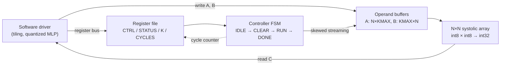
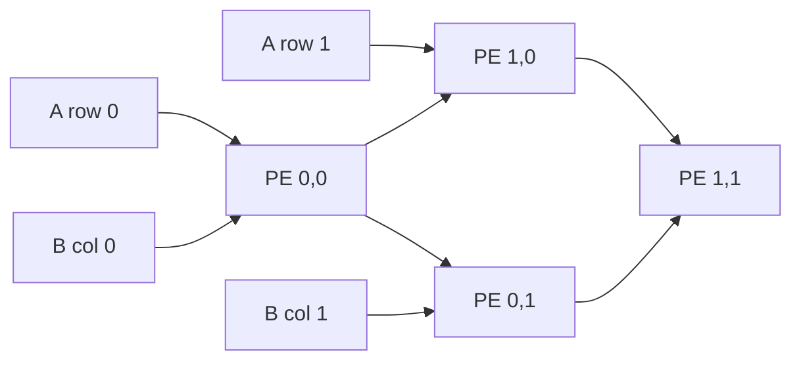
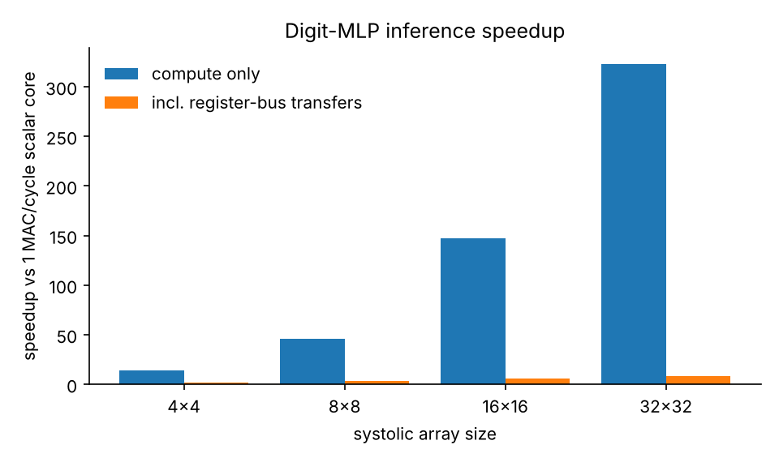

# Systolic-Array Neural-Network Accelerator


A parameterizable **N×N output-stationary systolic array** in Verilog, wrapped into a small accelerator
(operand buffers, controller FSM, performance counter, memory-mapped register bus) and driven by a
Python tiling driver that runs **int8 neural-network inference**. Every matrix multiply of a quantized
digit-recognition MLP runs on the accelerator model, and the output is **bit-exact** against a NumPy
int8 reference.

```
$ make demo
float32 MLP accuracy:          97.33%
int8 accelerator accuracy:     97.33%
bit-exact vs NumPy int8:       True
Array size:                    8 x 8  (64 MACs/cycle peak)
Speedup (compute only):        46.3x
Speedup (incl. bus transfers): 3.2x
```

## Architecture



Each processing element multiplies the two operands it receives, adds the product to a local int32
accumulator, and forwards both operands to its right and bottom neighbours. Row *i* of A and column *j*
of B are delayed by *i* and *j* cycles, so PE(i,j) sees `A[i][k]` and `B[k][j]` together at cycle
`t = k + i + j`.



**Run time:** one tile with inner dimension `K` takes `K + 2N − 2` cycles (`3N − 2` when `K = N`).
The testbench checks this against the hardware cycle counter for every test case.

## Results

Workload: int8 MLP (64→32→10) on the scikit-learn digits test set, 450 images, all matrix multiplies on
the accelerator model. Baseline is an *idealised* scalar core doing 1 MAC per cycle with zero loop or load
overhead (a real CPU is slower, so this baseline is conservative).

| N | Peak MACs/cycle | Tiles | Compute cycles | Utilization | Speedup (compute) | Speedup (incl. bus) |
|---|---|---|---|---|---|---|
| 4 | 16 | 1243 | 76,162 | 87.4% | 14.0x | 1.6x |
| 8 | 64 | 342 | 23,028 | 72.3% | 46.3x | 3.2x |
| 16 | 256 | 87 | 7,250 | 57.4% | 147.0x | 6.0x |
| 32 | 1024 | 30 | 3,300 | 31.5% | 322.9x | 8.4x |



Two honest observations the numbers show:

- **Utilization drops as N grows**: the workload's matrices are small (64 and 32 wide), so larger
  arrays spend more time filling and draining (`2N − 2` overhead cycles per tile) and waste lanes on edge tiles.
- **The register bus is the bottleneck, not the array.** Loading operands at one word per cycle with no
  overlap caps end-to-end speedup near N/2. Fixing this (wider bus, DMA, double-buffered operand
  SRAMs) is the most valuable next step.

Regenerate with `make bench`.

## Repository layout

```
rtl/
  pe.v               processing element (MAC + operand forwarding)
  systolic_array.v   N×N array, parameterized
  sa_accel.v         top level: buffers, controller FSM, perf counter, register bus
tb/
  tb_sa_accel.v      self-checking testbench (loads operands over the bus, checks C and cycle count)
sw/
  accel_model.py     cycle-accurate Python model + tiling driver
  quant_mlp.py       train and quantize the digit MLP (int8)
  demo.py            end-to-end inference demo
  benchmark.py       array-size sweep -> docs/results.md, docs/speedup.png
  test_accel_model.py
scripts/
  run_rtl_tests.py   runs the testbench over many (N, K, data) cases with Icarus Verilog
.github/workflows/ci.yml
```

## Quick start

```bash
pip install -r requirements.txt
sudo apt install iverilog        # macOS: brew install icarus-verilog

make test    # Python model tests + Verilog testbench (all cases)
make demo    # digit-recognition inference on the accelerator model
make bench   # sweep N = 4, 8, 16, 32
make wave    # dump build/wave.vcd, open it in GTKWave
```

## Register map

| Address (word) | Name | Access | Description |
|---|---|---|---|
| `0x0000` | CTRL | W | bit0 = start |
| `0x0001` | STATUS | R | bit0 busy, bit1 done, bit2 error (invalid K) |
| `0x0002` | K | RW | inner dimension, 1…KMAX |
| `0x0003` | CYCLES | R | cycles the last run spent in the array |
| `0x0004` | N | R | array size (build parameter) |
| `0x0005` | KMAX | R | operand buffer depth (build parameter) |
| `0x1000 + i·KMAX + k` | A[i][k] | W | int8 |
| `0x2000 + k·N + j` | B[k][j] | W | int8 |
| `0x3000 + i·N + j` | C[i][j] | R | int32 |

## Verification

- `tb/tb_sa_accel.v` loads random int8 operands over the register bus, starts the run, then checks
  every output element **and** the cycle counter (`K + 2N − 2`).
- `scripts/run_rtl_tests.py` runs it for N ∈ {2, 4, 8} across many K values, plus corner cases
  (all −128, all +127, zeros, identity).
- `sw/test_accel_model.py` checks the Python model against NumPy for arbitrary matrix sizes, including
  tiling and int8 extremes.
- CI runs all of the above on every push.

## Design decisions

- **Output-stationary dataflow:** each PE keeps its partial sum in place, so the only data moving each
  cycle is the int8 operands. This keeps wiring short and makes the int32 accumulator the only wide register.
- **int8 × int8 → int32:** matches common inference accelerators and gives 2^17 accumulations of headroom
  before overflow.
- **Zero-padded streams instead of enables:** operands outside the valid window are driven as zero, so
  PEs need no enable logic and a finished run leaves the array stable.
- **Tiling in software:** the hardware handles one N×N tile with K ≤ KMAX; the driver tiles larger
  matrices and accumulates K-chunks, keeping the RTL small and verifiable.

## Limitations and future work

- Operand buffers use combinational reads (simple and clear in simulation). For FPGA block RAM they
  should become synchronous-read with one extra pipeline stage, ideally double-buffered so loading
  overlaps compute.
- Register bus is a simple memory-mapped interface; an AXI4-Lite wrapper would allow integration into a SoC.
- Requantization between layers runs on the host; moving it on-chip would make a fully on-device pipeline.
- Synthesis results (LUTs, DSPs, Fmax) on a target FPGA are not yet measured.

## License

MIT, see [LICENSE](LICENSE).
